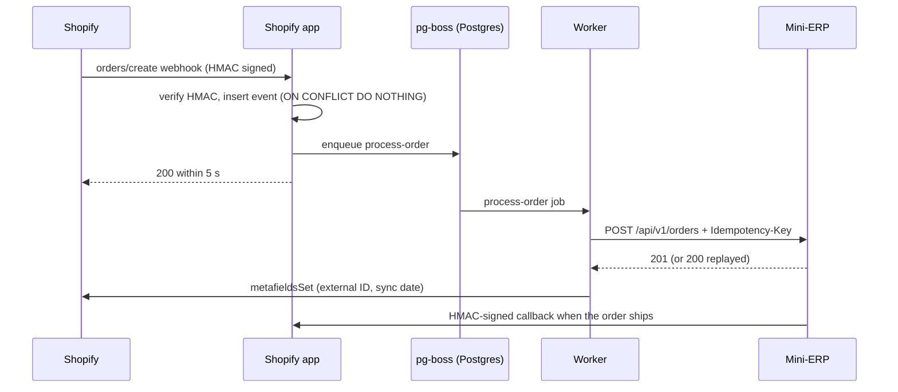

# Architecture

## Order flow

Shopify delivers webhooks at least once, not exactly once. Every step is therefore safe to
replay, and a nightly job covers webhooks that never arrive.

## Idempotency

Each layer relies on a database constraint rather than an application-level check.

- **Webhook intake.** `webhook_events.shopify_webhook_id` is unique and the insert uses
  `ON CONFLICT DO NOTHING`. A replayed delivery produces no row and no job.
- **Order tracking.** `orders_summary (shop, shopify_order_id)` is unique and the worker
  upserts it. Two distinct webhooks for the same order share one tracking row.
- **ERP call.** The worker sends an `Idempotency-Key` derived from the order
  (`order:<shop>:<order id>`), not from the delivery: two webhooks for the same order, or a
  webhook and the nightly reconciliation, send the same key. The ERP follows Stripe's
  contract:
  - unknown key: the request is processed, `201`;
  - same key, same body: the stored response is replayed, `200` with
    `Idempotency-Replayed: true`;
  - same key, different body: `422`.

The ERP checks the key, creates the order and stores the response in one transaction that
holds an advisory lock on the key. Concurrent requests with the same key wait for the first
one and replay its response, and a crash cannot leave an order without its key.

The key also covers the case where the ERP stores the order but the connection drops before
the response: the worker retries with the same key and gets the stored response back. Chaos
mode reproduces this case (`lostResponseRate`).

## Error handling

Every ERP error body is `{ code, message, retryable }`. The worker decides on `retryable`
and only falls back to the HTTP status when the body is unusable.

| Situation | Response | Worker |
| --- | --- | --- |
| Validation error, unknown SKU | `400` / `422`, not retryable | dead-letter |
| Out of stock | `409`, not retryable | dead-letter |
| Invalid API key | `401`, not retryable | dead-letter |
| ERP unavailable | `503`, retryable | retry with backoff: 5, 10, 20, 40, 80 s |
| Throttled | `429` + `Retry-After` | job rescheduled after `Retry-After` |
| Timeout, dropped connection | none | retry; the idempotency key prevents a duplicate |

Dead-lettered orders show up on the Polaris screen with a retry button. Reconciliation
skips them: they need a human decision.

## Nightly reconciliation

A scheduled pg-boss job runs at 3 a.m. It pages through the orders of the last 24 hours with
the Admin GraphQL API, compares them with `orders_summary`, and re-enqueues the missing ones.
Running it twice enqueues nothing more.

The Admin client reads `extensions.cost.throttleStatus` and waits when the point budget runs
low, instead of waiting for a `429`.

## Catalog import

`npm run catalog:import` pages through every product variant of the store and sends SKUs and
titles to `POST /api/v1/stock/import`. Unknown SKUs are created with a default quantity;
known SKUs only get their title updated. The ERP keeps ownership of quantities, and the
import can be run again safely. Variants without a SKU are reported, since their orders
cannot be matched.

## Mini-ERP

A Hono service with its own `erp` schema in the same Postgres.

- API (`/api/v1`, `X-Api-Key`): create, list, get, cancel and ship orders; list and import
  stock. `GET /health` queries the database.
- Order creation and stock decrement run in one transaction, with `SELECT … FOR UPDATE` on
  each stock row.
- Chaos mode, set from the admin UI: `503` rate, `429` rate, latency, lost responses.
- Shipping an order sends an HMAC-signed callback to the app, using the same scheme as
  Shopify webhooks.
- `X-Request-Id` is reused in logs and echoed in responses.
- Request log (`/request-log` in the UI): every API call with its idempotency key, status,
  outcome (created, replayed, lost response…) and duration. It stores no customer data.

### Access

- The app and the worker authenticate with an API key, compared with `timingSafeEqual`.
- People sign in to the UI with email and password (Better Auth, cookie session). Roles are
  `admin` and `demo`.

### Demo role

The `demo` role sees the whole UI with personal data masked server-side, in
`serializeOrder(order, role)`, which every order goes through before reaching a response:

- name reduced to initials, email truncated, phone masked except the last two digits;
- a stable HMAC-derived pseudonym (`client-aa34`) to recognize a returning customer;
- no search by name or email, no export.

A test checks that none of the real values appear in the dashboard response. The pseudonym
is pseudonymization in the GDPR sense, not anonymization.

## Operations

- Logs: pino, JSON, stable event names (`order.synced`, `shutdown.requested`…), personal
  fields redacted.
- Configuration is validated with Zod at startup.
- Graceful shutdown on `SIGTERM`: the ERP drains in-flight requests, the worker lets pg-boss
  finish running jobs before closing the pool.
- Docker images are multi-stage, run as a non-root user, with Node as PID 1.
